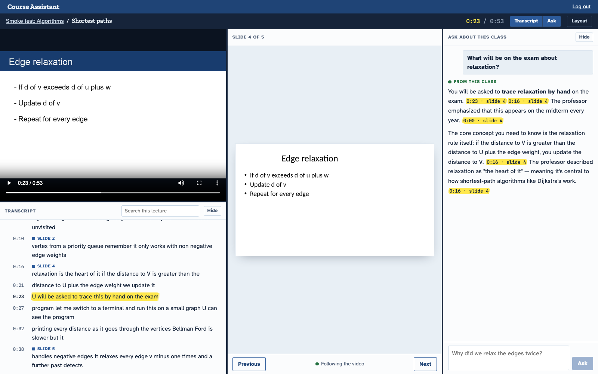

# Course Assistant

Turn recorded lectures into something students can search and question. Upload a class video
(plus slides and a transcript if you have them), and Course Assistant transcribes it, syncs the
slides to the video, builds a knowledge graph of what was taught, and answers student questions
from that class only. Every answer cites the exact second of video it came from.



## What it does

- **Synced player.** Video, current slide and transcript move together. Click any transcript
  line or citation to jump to that moment.
- **Answers grounded in the class.** The assistant retrieves passages from the lecture and
  marks each answer as from this class, partly covered, or not covered. General knowledge goes
  under a separate "Beyond the class material" heading. Citations are checked against their
  sources before a student sees them.
- **Concept map.** Concepts and their links (needed before, part of, used for, ...) are merged
  across lessons into one 3D map per course.
- **Review before publishing.** Admins fix the slide timeline and transcript lines, then
  publish. Students never see a draft.
- **Runs on one machine.** Everything except the LLM runs locally in Docker Compose.

## How it works

```
video ─► ffmpeg ─► faster-whisper ─► transcript ┐
deck  ─► LibreOffice ─► slide images + OCR ─────┼─► slide sync ─► passages ─► bge-m3 embeddings
                                                │                    │
                                                └────────────► your LLM: concepts, statements,
                                                                relations ─► knowledge graph
question ─► hybrid search + graph expansion ─► your LLM ─► citation check ─► answer
```

Stack: FastAPI, Celery, PostgreSQL with pgvector, Redis, MinIO, React 19 with Vite, nginx.

## Requirements

- Docker Desktop with about 10 GB of memory (Settings, Resources).
- An LLM you can reach over HTTP (see [Connect your own LLM](#connect-your-own-llm)).
- About 2.3 GB of disk per 90-minute lesson, plus 2.3 GB for the embedding model.

## Quick start

1. Download the Whisper weights once. They are mounted read-only into the worker:

   ```sh
   uvx --from huggingface_hub hf download Systran/faster-whisper-small
   ls ~/.cache/huggingface/hub/models--Systran--faster-whisper-small/snapshots   # the snapshot id
   ```

2. Configure and start:

   ```sh
   cp .env.example .env    # fill in the four secrets, the LLM settings, and the Whisper paths
   docker compose up -d --build
   ```

3. Open <http://localhost:8080> and log in with `ADMIN_EMAIL` and `ADMIN_PASSWORD` from `.env`.

The first start downloads bge-m3 (about 2.3 GB); search and slide sync wait for it. Follow it
with `docker compose logs -f models`. If the download drops, run `docker compose up -d` again and
it resumes.

There is no sign-up page. Add students from the command line:

```sh
docker compose exec api python -m app.cli create-user student@example.edu 'password'
```

## Connect your own LLM

No model is bundled or hosted for you. Point the app at any LLM you are allowed to use, in
`.env`:

```sh
LLM_BASE_URL=https://api.your-provider.com/v1   # or a local server, e.g. http://host.docker.internal:8000/v1
LLM_MODEL=your-model-name
LLM_API_KEY=...                                 # leave empty if your server needs no key
```

Then run `docker compose up -d`. Check the endpoint first:

```sh
curl -sS -H "Authorization: Bearer $LLM_API_KEY" "$LLM_BASE_URL/models"
```

The endpoint must:

- speak the OpenAI `POST /v1/chat/completions` format;
- support structured output with `response_format: {"type": "json_schema", ...}`, which knowledge
  extraction depends on;
- accept the extra field `chat_template_kwargs: {"enable_thinking": false}`. vLLM and SGLang
  honour it. Some hosted APIs reject unknown fields with a 400; if yours does, remove that line
  from [backend/app/core/llm.py](backend/app/core/llm.py).

The project was developed and evaluated against GLM-5.2 served through an OpenAI-compatible
endpoint. Other models with reliable JSON-schema output should work but are untested. Run the
live checks against your model before trusting it:

```sh
cd backend && LLM_BASE_URL=... LLM_MODEL=... LLM_API_KEY=... uv run pytest -m llm
```

**What leaves your machine:** questions and lecture text (transcripts, slide text) go to the LLM
endpoint. Video, audio, student names and emails do not. Read your provider's data-use terms
before processing real lectures, and prefer an HTTPS endpoint or a self-hosted model.

## Use it

1. **Manage courses**: create a course, then add a lesson.
2. Open the lesson. Video, Presentation and Transcript each have their own upload box; only the
   video is required. Upload in any order, then press **Save** to start processing. Progress
   shows live. A transcript can be `.srt`, `.vtt` or `.pdf`. A PDF whose lines carry times like
   `00:01:23` is used as is. A PDF without times is matched to the speech automatically, keeping
   your wording. Uploading a new transcript for a published lesson makes a new draft, and
   students keep the old lines until you publish it.
3. At **Ready for review**, choose **Watch as a student**, fix the slide timeline and any
   transcript lines, then **Publish**.
4. On the course page, **Publish course** so students can see it.

A 90-minute lecture takes an estimated 1 to 2.5 hours on an M1 Pro, so run batches overnight.

### When the LLM is down

Chat shows "Assistant offline"; video, transcript and slides keep working. Lessons wait at
**Extract what was taught** and retry every 5 minutes, so an outage delays them without failing
them. Fix `LLM_BASE_URL` in `.env`, then run `docker compose up -d`.

## Develop

Backend tests use real Postgres with pgvector and never touch the network:

```sh
createdb course_test
cd backend && uv sync --all-extras && uv run pytest
```

The tests connect as a local Postgres user; change `DATABASE_URL` in
[backend/tests/conftest.py](backend/tests/conftest.py) to match yours.

```sh
cd frontend && npm install && npm test && npm run dev   # dev server proxies to localhost:8080
```

End-to-end without any real LLM, using a stand-in that builds replies mechanically:

```sh
cd backend
uv run uvicorn tests.fake_glm:app --port 9100 &
LLM_BASE_URL=http://host.docker.internal:9100/v1 LLM_MODEL=GLM-5.2 docker compose up -d
uv run python ../scripts/make_sample_lecture.py /tmp/sample      # macOS only, uses `say`
docker compose exec api python -m app.cli create-user smoke@example.edu smoke-pass
ADMIN_EMAIL=... ADMIN_PASSWORD=... SMOKE_STUDENT_EMAIL=smoke@example.edu \
  SMOKE_STUDENT_PASSWORD=smoke-pass uv run python ../scripts/smoke_test.py /tmp/sample
```

## Evaluate

- **Slide sync:** hand-label a lecture, publish it, then
  `python eval/sync_eval.py labels.json REVISION_ID`.
- **Answer quality:** write questions in the shape of
  [eval/questions.example.json](eval/questions.example.json), then
  `cd backend && uv run python ../eval/run_eval.py ../eval/questions.json`. It compares the
  assistant with the same model given no course data, and writes `report.json`. Needs a real LLM.

## Operate

- **Backups:** `scripts/backup.sh /Volumes/Backup/course-assistant`, weekly, to a separate drive.
- **Disk:** about 2.3 GB per lesson. Check free space before uploading a batch.
- **Sleep:** keep the host awake while people use it, for example with `caffeinate -s` on macOS.
- **Network:** port 8080 is open to your local network. Do not expose it to the internet.
- **Slow downloads:** `.env.example` lists optional PyPI, Debian, npm and model mirrors.

## Third-party models and tools

Nothing below is redistributed in this repository. Docker pulls or builds each piece on your
machine, and each keeps its own license.

| Component | Used for | License | What to know |
|---|---|---|---|
| [faster-whisper](https://github.com/SYSTRAN/faster-whisper) + [Systran/faster-whisper-small](https://huggingface.co/Systran/faster-whisper-small) | Speech to text | MIT | Free for any use, keep the notice. |
| [BAAI/bge-m3](https://huggingface.co/BAAI/bge-m3) | Embeddings for search and sync | MIT | Free for any use, keep the notice. |
| [RapidOCR](https://github.com/RapidAI/RapidOCR) | Text on slides and video frames | Apache-2.0 | Keep the notice; state changes if you modify it. |
| [LibreOffice](https://www.libreoffice.org/) | Deck to images, in a no-network container | MPL-2.0 | Run as a separate program; no obligations for this code. |
| [FFmpeg](https://ffmpeg.org/legal.html), [Poppler](https://poppler.freedesktop.org/) | Audio, HLS video, PDF pages | GPL / LGPL | Called as separate programs from Debian packages. If you publish built images, you must offer their source. |
| [MinIO](https://github.com/minio/minio) | Object storage | AGPL-3.0 | Used unmodified. The upstream project is archived and stopped publishing images in 2025, so the pinned image gets no security fixes. Keep it on a private network. |
| [Redis](https://redis.io/legal/licenses/) | Task queue | BSD-3 up to 7.2; RSALv2/SSPLv1 for 7.4+ | Fine for self-hosting. Do not offer Redis itself as a hosted service. Pin `redis:7.2-alpine` if you need an OSI license. |
| [PostgreSQL](https://www.postgresql.org/about/licence/) + [pgvector](https://github.com/pgvector/pgvector) | Database and vector search | PostgreSQL License | Free for any use. |
| macOS `say` (only in `scripts/make_sample_lecture.py`) | Narration for the synthetic test lecture | Apple macOS license | Apple allows system voices only for personal, non-commercial use and forbids publishing or redistributing their output. Generate the sample locally for testing; do not publish the audio or video. |
| Your LLM | Extraction, concept merging, answers | Your provider's terms | You are responsible for its terms of use and for the lecture text you send it. |

Fonts: Geist and Spline Sans Mono, both SIL Open Font License 1.1, via Fontsource.

### Lecture material

No lectures are included. To try the system with a real class, MIT OpenCourseWare publishes
[6.0001 Introduction to Computer Science and Programming in Python](https://ocw.mit.edu/courses/6-0001-introduction-to-computer-science-and-programming-in-python-fall-2016/)
with video and slides under [CC BY-NC-SA 4.0](https://ocw.mit.edu/terms/): non-commercial use,
credit MIT and the instructors, and share adaptations under the same license. Only upload
recordings you have the right to process, and get consent where students' voices or faces appear.

## License

[MIT](LICENSE). Third-party models, tools and lecture material keep their own licenses, listed
above.
